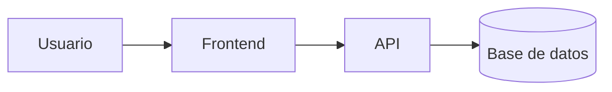

# App Notas


Aplicacion web sencilla para guardar notas desde el navegador. Pensada para estudiantes que necesitan apuntar ideas rapidas sin instalar ningun programa. '

## Tabla de contenidos

- [Instalacion](#instalacion)
- [Uso](#uso)
- [Estado de las funciones](#estado-de-las-funciones)
- [Arquitectura](#arquitectura)
- [Contribucion](#contribucion)
- [Licencia](#licencia)

## Instalacion

```bash
git clone https://github.com/TU-USUARIO/app-notas.git cd app-notas
```

## Uso

1. Abrir el archivo `index.html` en el navegador.
2. Escribir una nota en el campo de texto.
3. Hacer clic en **Agregar**.
   V

## Arquitectura


